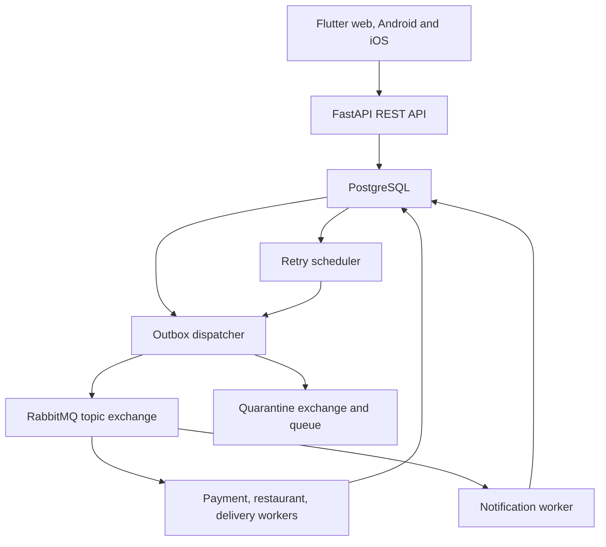
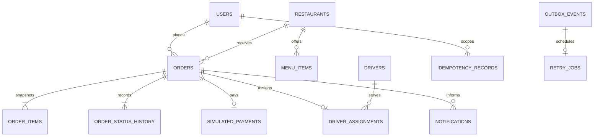
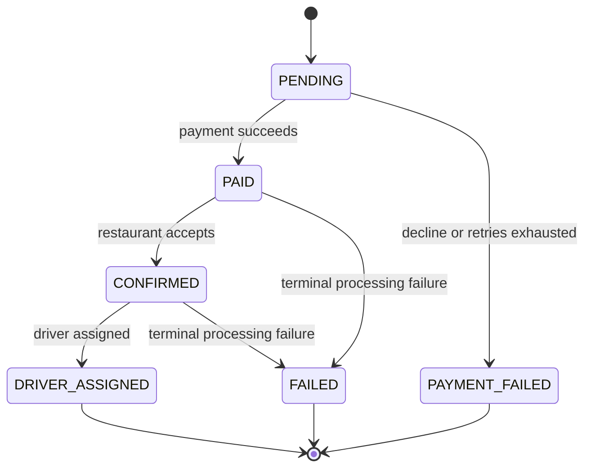

# Architecture

QuickBite is a modular event-driven training system with one shared PostgreSQL database. Flutter is the only user interface and communicates only with FastAPI over REST. No client contains database or broker credentials.

## Client boundary

Flutter holds only public API configuration. The client sends menu item IDs, quantities and a delivery address; the server derives customer identity and price from authenticated/database state. PostgreSQL is authoritative for all statuses. Polling runs around every two seconds on visible active details, backs off up to 30 seconds on failures, stops in the background and on terminal status, and refreshes when resumed. A manual refresh retrieves late notifications after terminal status.

The public landing preview has its own bounded `/api/v1/public/catalog` route. Required catalogue routes remain authenticated. Backend role checks protect administration even if a client is modified. Cross-customer detail/history/notification requests return 404.

## Data relationships

Other records: `processed_events` gives a unique logical consumer/event key; `quarantine_records` stores original messages and failure metadata; `demo_checkpoints` makes intentional crashes repeatable once per identity/checkpoint. These operational event identities deliberately do not depend on foreign keys to valid orders, because malformed messages must be retainable.

| Constraint | Purpose |
|---|---|
| users.email | Unique account |
| idempotency_records(customer_id,key) | One accepted response per customer/key |
| simulated_payments.order_id | One committed simulated payment per order |
| driver_assignments.order_id | One committed assignment per order |
| notifications(customer_id,event_id) | One notification per customer/domain event |
| order_status_history(order_id,version) | One history entry per version |
| processed_events(consumer_name,event_id) | Logical worker deduplication across replicas |
| retry_jobs(consumer_name,event_id,attempt) | One retry schedule per attempt |
| quarantine_records(consumer_name,event_id) | One logical quarantine |
| outbox_events.id | Unique domain, retry or quarantine publication |

A database trigger rejects history UPDATE/DELETE. Another rejects backward/invalid order status changes and requires a version increment for each transition. SQL constraints enforce positive quantities and nonnegative amounts. Alembic owns schema setup; workers do not run migrations.

## Order state machine

DRIVER_ASSIGNED is the successful end of this simulation. Notification failures never enter this state machine. Transient failures do not advance or regress an order. A post-payment failure does not claim a refund.

## Process ownership

| Process | Responsibility |
|---|---|
| API | Auth, browsing, atomic order acceptance, authorized read models |
| Payment worker | Simulated payment, PENDING to PAID/PAYMENT_FAILED |
| Restaurant worker | PAID to CONFIRMED/FAILED |
| Delivery worker | CONFIRMED to DRIVER_ASSIGNED/FAILED |
| Notification worker | Independent persisted notifications |
| Outbox dispatcher | Safe confirmed publication and delayed republish on outage |
| Retry scheduler | Release due, previously committed targeted publications |
| Migration / seed commands | Deliberate setup, not concurrent worker startup work |

See [reliability](reliability.md) for the failure boundaries.
