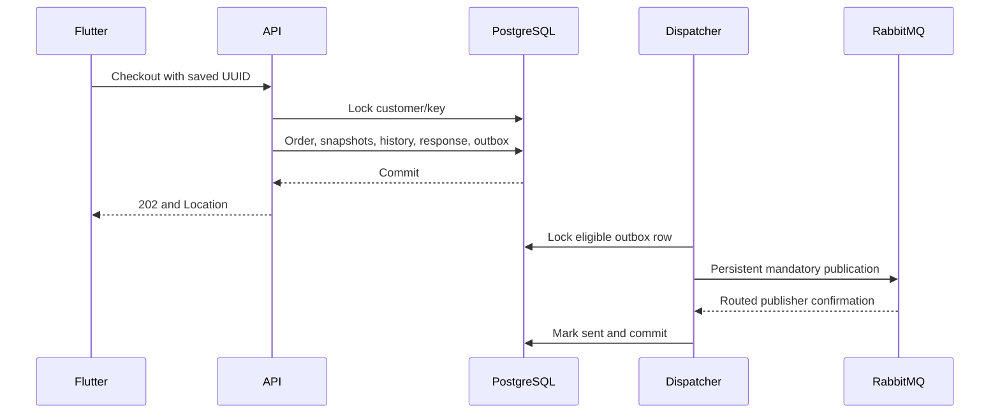
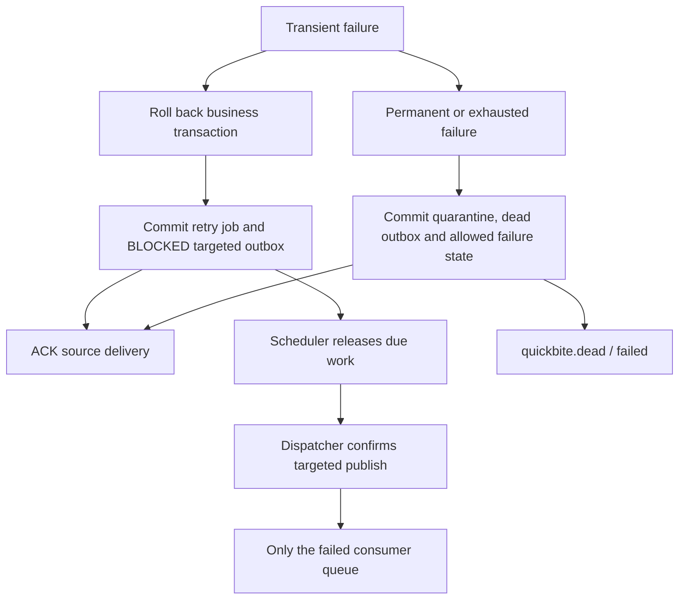

# Reliability and failure boundaries

The design uses at-least-once message delivery and database-protected single committed simulated business effects. It does **not** claim exactly-once messaging or external payment guarantees. Execution evidence remains pending.

## Checkout and publication



A transaction-scoped advisory lock serializes initial requests with the same customer/key, including concurrent requests before the unique record exists. Canonical hashing sorts item IDs and normalizes the address through the request schema. A matching hash returns the original PENDING acceptance and Location even if the order has progressed. A different hash returns 409. The unique primary key remains the database backstop. Records are retained for the assignment lifetime. Production retention would require a documented client retry horizon and reconciliation policy; no expiry cleanup is silently applied here.

The dispatcher uses `FOR UPDATE SKIP LOCKED` and holds the row lock over a bounded publication. It declares all queues and bindings before dispatch. Its channel enables publisher confirms and `on_return_raises`; publication uses `mandatory=True`. Only a Basic.Ack without an unroutable return marks SENT. Broker errors persist an increasing bounded republish delay. A dispatcher crash after publish and before commit leaves the row unsent and permits duplicate delivery. This is why consumers deduplicate.

## Worker transaction and acknowledgements

Logical consumer names are payment, restaurant, delivery and notification; process instance IDs only appear in logs. Each processing transaction obtains an advisory lock for the logical consumer/event, checks processed/quarantined/later retry records, then locks the order. It applies one allowed transition with payment/assignment/history/outbox rows and records processing in the same transaction. ACK is sent after commit.

Stale events are marked as handled no-ops without state regression. An event from a future order version or an unmet prerequisite is deferred through bounded retries, never silently discarded as success. A valid future event intentionally not supported by notifications is recorded as ignored, with a structured log.

Database uniqueness protects payment, assignment, notifications and order versions even across replicas. A real external payment provider would additionally need provider-side idempotency and reconciliation; that is outside this simulation.

## Retry and quarantine



Default attempts are initial attempt 0, then attempts 1/2/3 at approximately 2/10/30 seconds. The actual lower bound includes scheduler cadence and broker availability. Attempts are delivery metadata; `event_id` never changes. The retry transaction stores both a `retry_jobs` row and an exact outgoing envelope in a BLOCKED outbox row. The scheduler marks due records RELEASED/PENDING. The dispatcher publishes through the **default exchange** with routing key `<consumer>.queue`, preserving domain identity and avoiding unrelated subscribers.

Unique consumer/event/attempt constraints stop duplicate scheduling. A duplicate original delivery that arrives after a retry is already durable is acknowledged as an older delivery. A failed retry-scheduling transaction escapes without ACK; channel closure allows broker redelivery after reconnect backoff. There is no known-failure `nack(requeue=true)` loop.

After final failure, quarantine and a `quickbite.dead` publication commit together. Payment failure becomes PAYMENT_FAILED only for a validated created event at the matching current PENDING version. Restaurant/delivery failures become FAILED only at their matching expected state/version. Notification quarantine never mutates the business state. Invalid/malformed/unsupported-schema messages are retained without using their untrusted order references to change orders. Raw messages are retained in PostgreSQL and the dead queue; the admin API omits raw payloads to avoid exposing unsolicited sensitive content.

## Shutdown, health and logging

Consumer prefetch is finite. SIGTERM stops taking local work after the current delivery, cancels consumption and closes the channel; prefetched unacknowledged messages can redeliver. Compose gives 35 seconds for graceful shutdown. Broken connections reconnect with increasing backoff up to 30 seconds. PostgreSQL connections use pre-ping and bounded connection/statement/lock timeouts.

The API live endpoint checks the process. Ready checks PostgreSQL plus the applied migration with a 2-second bound, and reports broker availability with a 1-second bound. Database unavailability is 503. Broker outage is degraded 200 because PostgreSQL acceptance remains usable. Long-running process heartbeats are separate from the API readiness contract.

Logs include service, instance, result and appropriate request/correlation/order/event/attempt/timing fields. SQL parameter values are hidden. Request body, delivery address, password and bearer token are not deliberately logged.

## Inspection queries

Run these only against the desired local demo database:

```sql
SELECT status, count(*) FROM orders GROUP BY status;
SELECT state, count(*), min(created_at) FROM outbox_events GROUP BY state;
SELECT consumer_name, event_id, attempt, due_at, state FROM retry_jobs ORDER BY created_at;
SELECT consumer_name, attempts, failure_code, created_at FROM quarantine_records;
SELECT order_id, count(*) FROM simulated_payments GROUP BY order_id HAVING count(*) > 1;
SELECT order_id, count(*) FROM driver_assignments GROUP BY order_id HAVING count(*) > 1;
SELECT order_id, version, count(*) FROM order_status_history GROUP BY order_id, version HAVING count(*) > 1;
```

The last three queries should return no rows when the implementation is validated; they have not been executed for this delivery. Local named volumes protect process/container restarts, not disk failure or cluster loss.
