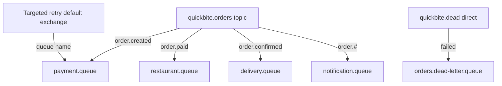

# Domain events and delivery metadata

Domain exchange: durable topic `quickbite.orders`. Main queues are durable, non-exclusive and not auto-delete. Topology is declared before dispatch and each consumer connects with manual ACK and finite prefetch.

| Queue | Binding | Logical consumer |
|---|---|---|
| payment.queue | order.created | payment |
| restaurant.queue | order.paid | restaurant |
| delivery.queue | order.confirmed | delivery |
| notification.queue | order.# | notification |

The hash wildcard is intentional: `order.*` would miss `order.payment.failed` and `order.driver.assigned`.



Every domain envelope contains:

```json
{
  "event_id":"3a779c67-594a-4a97-9e88-837fcf10cd12",
  "schema_version":1,
  "event_type":"order.paid",
  "order_id":"QB-example",
  "order_version":2,
  "occurred_at":"2026-10-16T12:00:00Z",
  "correlation_id":"8e2afbe7-947b-4a32-853d-bffb3fba47f0",
  "causation_id":"f8b97fab-3527-4888-a8a1-518303de4821",
  "data":{"payment_id":"simulated-payment-id"}
}
```

This is an illustrative schema example, not execution evidence. [event.schema.json](event.schema.json) is exported from the Pydantic envelope.

`event_id` and AMQP `message_id` must match and are immutable across retries. Children retain correlation_id and use the incoming event_id as causation_id. Messages are persistent JSON. Attempts belong in AMQP headers `{attempt,consumer}` and durable retry rows, not in a new domain-event identity. Database workers load the authoritative order; delivery addresses, passwords and tokens do not belong in these events.

| Event | Produced by | Relevant data |
|---|---|---|
| order.created | Acceptance transaction | restaurant_id |
| order.paid | Payment worker | payment_id |
| order.payment.failed | Payment failure handling | failure_code |
| order.confirmed | Restaurant worker | Empty object |
| order.driver.assigned | Delivery worker | driver_id |
| order.failed | Restaurant/delivery failure | failure_code |

Retry outbox destinations use the default exchange and one queue name. Quarantine is an operational envelope, not a new domain transition: it holds quarantine_id, original_event, source_consumer, source_queue, attempts, failure_code and occurred_at. It is published durably to direct exchange `quickbite.dead`, routing key `failed`, bound to `orders.dead-letter.queue`.

Malformed envelopes, unsupported schema versions and inconsistent AMQP identity are quarantined without touching an untrusted order reference. A valid future `order.*` event can be intentionally ignored by notifications with a durable processed marker and structured log.
